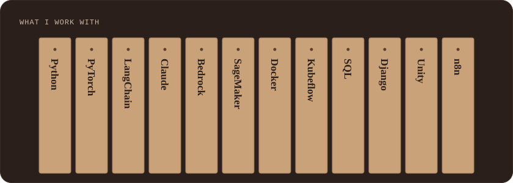
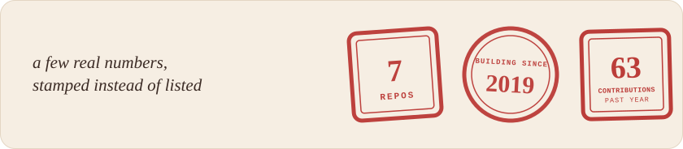
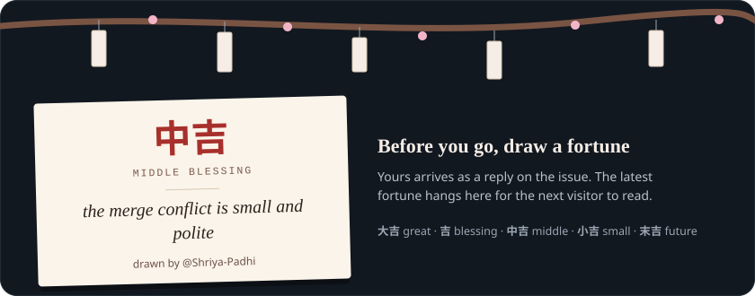
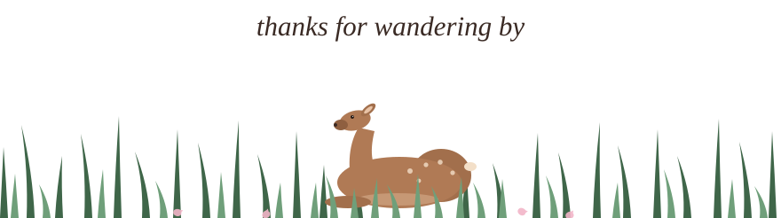

<!-- This README is generated by scripts/garden.py from profile.json. Edit profile.json, not this file. -->

  

<picture>
  <source media="(prefers-color-scheme: dark)" srcset="assets/vine-menu-dark.svg">
  
</picture>

  

<picture>
  <source media="(prefers-color-scheme: dark)" srcset="assets/vine-currently-dark.svg">
  
</picture>

  

  

<b>Outside the code:</b> mentoring women in STEM (USC SWE, USC GRIDS) · TA for DSCI 250 and USC Robogals · writing essays and poems

<picture>
  <source media="(prefers-color-scheme: dark)" srcset="assets/vine-fortune-dark.svg">
  
</picture>

  

  

 

<picture>
  <source media="(prefers-color-scheme: dark)" srcset="assets/footer-dark.svg">
  
</picture>

  

